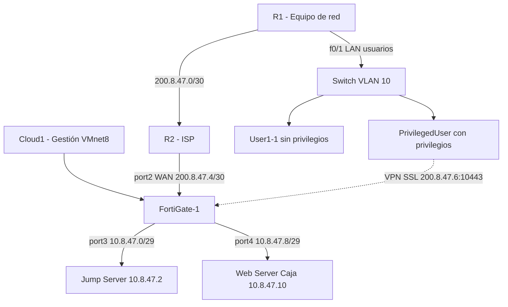

# Infraestructura 2 - VPN Remote-Site, Jump Server y Web Server Caja

## Video demostrativo

[Ver video en YouTube](ENLACE_DEL_VIDEO)

## Propósito del laboratorio

Diseñar una infraestructura con acceso remoto seguro: un cliente se conecta por VPN SSL a un Jump Server, que es el único punto autorizado para llegar a un Web Server de caja mediante HTTPS, RDP y SSH. Se publican aplicaciones con RemoteApp y RD Web Access, y se restringen los accesos de los usuarios sin privilegios (sin SSH a servidores) y con privilegios (Web, PuTTY y RDP en el Jump).

## Topología

## Plan de direccionamiento

| Segmento | Red | Gateway | Equipo |
|---|---|---|---|
| Enlace R1 ↔ R2 | 200.8.47.0/30 | 200.8.47.1 (R2) | R1: 200.8.47.2 |
| Enlace R2 ↔ FortiGate | 200.8.47.4/30 | 200.8.47.5 (R2) | FortiGate port2: 200.8.47.6 |
| LAN usuarios VLAN 10 | 10.8.46.0/25 | 10.8.46.1 (R1) | User1-1 10.8.46.2, PrivilegedUser 10.8.46.5 (DHCP) |
| LAN Jump | 10.8.47.0/29 | 10.8.47.1 (FortiGate port3) | Jump 10.8.47.2 |
| LAN Web | 10.8.47.8/29 | 10.8.47.9 (FortiGate port4) | Web 10.8.47.10 |

## Configuración

- **R1 (equipo de red):** f0/0 hacia R2 (200.8.47.2/30), f0/1 hacia la LAN de usuarios (10.8.46.1/25), ruta por defecto hacia R2 y rutas estáticas a las LAN del Jump y del Web. DHCP para VLAN 10 con reserva para User1-1.
- **R2 (ISP):** enlaces hacia R1 y FortiGate, rutas hacia 10.8.46.0/25, 10.8.47.0/29 y 10.8.47.8/29.
- **Switch:** puertos de usuarios en VLAN 10 (access) y enlace a R1.
- **FortiGate:** port1 gestión (Cloud1), port2 WAN (200.8.47.6/30), port3 LAN Jump, port4 LAN Web. Rutas estáticas: 0.0.0.0/0 por port2, 200.8.47.0/30 y 10.8.46.0/25 por port2.
- **Jump Server (Windows Server 2019):** RD Session Host, RD Web Access y RD Connection Broker en grupo de trabajo con dominio lab.local. RemoteApp: PuTTY, RDP y Navegador en la colección "Coleccion". Restricción: PuTTY y RDP solo para `usuario_priv`.
- **Web Server Caja:** HTTPS (puerto 443) y SSH (puerto 22).

### Objetos y políticas

| Política | Origen | Destino | Servicio | Acción |
|---|---|---|---|---|
| VPN | usuario_priv (SSL-VPN) | JUMP_SERVER | HTTPS, RDP | ACCEPT |
| NO_PRIVILEGE_USER | VLAN10_USUARIOS | JUMP_SERVER | HTTPS | ACCEPT |
| EXPLICIT_DENY | VLAN10_USUARIOS | JUMP_SERVER | SSH | DENY |
| EXPLICIT_DENY_2 | VLAN10_USUARIOS | WEB_CAJA | SSH | DENY |
| JUMP_TO_WEB | JUMP_SERVER | WEB_CAJA | HTTP, HTTPS, RDP, SSH | ACCEPT |
| DENY_JUMP_TO_WEB | JUMP_SERVER | WEB_CAJA | ALL | DENY |

## Pruebas y resultados

### Usuario sin privilegios
Solo HTTPS al Jump; SSH bloqueado hacia Jump y Web.

### Usuario con privilegios
Acceso directo RDP bloqueado; acceso por VPN al portal con Web, PuTTY y RDP.

### Jump hacia Web Server
Permitidos HTTPS, SSH y RDP; denegado el resto y el ping.

### Políticas

## Scripts

Configuración de IP de los equipos finales en [`scripts/ip_equipos_infra2.sh`](scripts/ip_equipos_infra2.sh).

## Running-configs

Pendientes: `configs/r1_running.txt`, `configs/r2_running.txt` y `configs/fortigate_backup.conf`.

