# Infraestructura 2 - VPN Remote-Site, Jump Server y Web Server Caja

## Video demostrativo

[Ver video en YouTube](https://www.youtube.com/watch?v=OzC4_yv7TUI)

## Propósito del laboratorio

Diseñar una infraestructura de acceso remoto seguro para una aplicación de caja. Un cliente remoto se conecta mediante VPN SSL (remote-site) a un Jump Server, que es el único punto autorizado para llegar a un Web Server mediante HTTPS, RDP y SSH. El Jump Server publica aplicaciones con RemoteApp y RD Web Access, y se aplican políticas diferenciadas para dos tipos de usuario:

- **Usuario sin privilegios:** solo accede al servicio Web publicado en el Jump, sin acceso SSH a los servidores.
- **Usuario con privilegios:** accede al Web, PuTTY y RDP publicados en el Jump, únicamente a través de la VPN.

El laboratorio demuestra segmentación de red, control de acceso por política, publicación de aplicaciones y acceso remoto cifrado.

## Topología

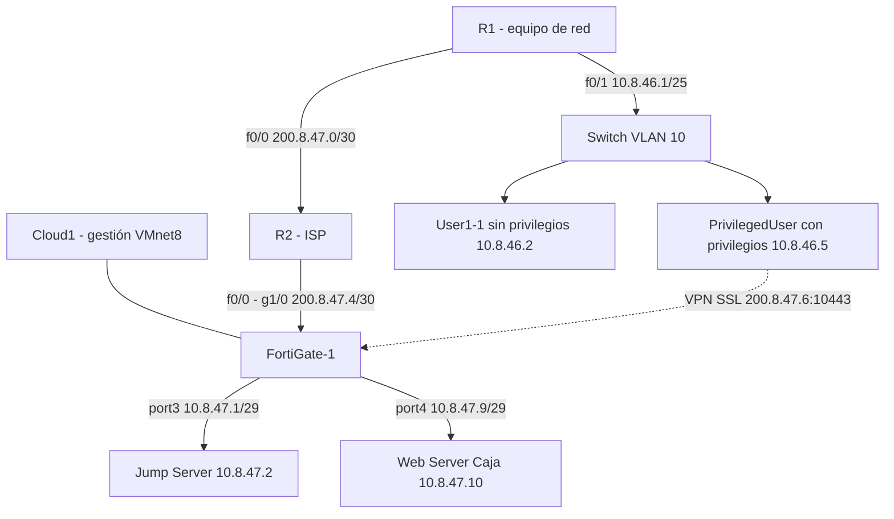

Cableado real en GNS3: R2 g1/0 hacia FortiGate port2; Cloud1 hacia FortiGate port1 (gestión); Cloud2 hacia FortiGate port3 (Jump); rastasheep hacia FortiGate port4 (Web); R1 f0/0 hacia R2 f0/0; R1 f0/1 hacia el switch.

## Plan de direccionamiento

Base 10.8.46.0 (matrícula 20250846).

| Segmento | Red | Gateway | Equipo |
|---|---|---|---|
| Enlace R1 ↔ R2 | 200.8.47.0/30 | 200.8.47.1 (R2) | R1: 200.8.47.2 |
| Enlace R2 ↔ FortiGate | 200.8.47.4/30 | 200.8.47.5 (R2) | FortiGate port2: 200.8.47.6 |
| LAN usuarios VLAN 10 | 10.8.46.0/25 | 10.8.46.1 (R1) | User1-1: 10.8.46.2, PrivilegedUser: 10.8.46.5 (DHCP con reserva) |
| Pool VPN SSL | 10.212.134.200 - 210 | - | Cliente con privilegios al entrar por el túnel |
| LAN Jump | 10.8.47.0/29 | 10.8.47.1 (FortiGate port3) | Jump Server 10.8.47.2 |
| LAN Web | 10.8.47.8/29 | 10.8.47.9 (FortiGate port4) | Web Server Caja 10.8.47.10 |

## Configuración

### Equipo de red R1 (Cisco C7200)

- f0/0 hacia R2: 200.8.47.2/30, ruta por defecto `0.0.0.0/0` vía 200.8.47.1.
- f0/1 hacia el switch de usuarios: 10.8.46.1/25.
- Rutas estáticas hacia 10.8.47.0/29, 10.8.47.8/29 y 200.8.47.4/30 vía 200.8.47.1.
- DHCP para VLAN 10 con exclusión de 10.8.46.1 y reserva para User1-1 (client-identifier de su MAC) para mantener su IP.

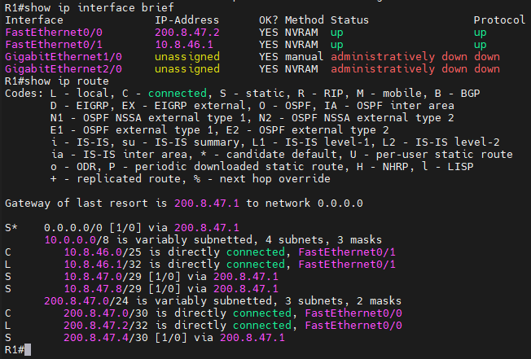

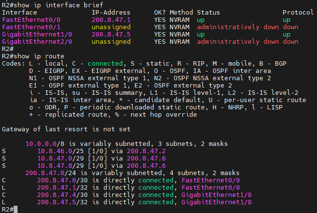

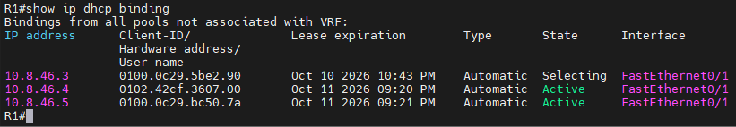

### ISP (R2)

Conecta las dos redes del enlace: hacia R1 (200.8.47.1/30) y hacia el FortiGate (200.8.47.5/30). Rutas estáticas hacia 10.8.46.0/25 (vía R1), 10.8.47.0/29 y 10.8.47.8/29 (vía FortiGate port2 200.8.47.6). El ISP es un router, no un Cloud, para que el tráfico tenga una ruta real de ida y vuelta.

### Switch de la LAN de usuarios

Puertos de usuarios en VLAN 10 (access) y enlace hacia R1. Se usa un switch porque dos clientes no pueden compartir un único puerto de router en la misma subred /25.

### FortiGate-1

- **port1:** gestión (Cloud1, VMnet8), acceso por GUI.
- **port2:** WAN hacia R2, 200.8.47.6/30. Acceso administrativo: PING para validar el enlace durante las pruebas.
- **port3:** LAN del Jump, 10.8.47.1/29.
- **port4:** LAN del Web, 10.8.47.9/29.
- **Rutas estáticas:** `0.0.0.0/0` por port2 vía 200.8.47.5; `200.8.47.0/30` y `10.8.46.0/25` por port2 vía 200.8.47.5. Esta última ruta de vuelta es necesaria, porque sin ella el firewall no sabe responder a los clientes de la LAN de usuarios y el reverse path check descarta el tráfico.

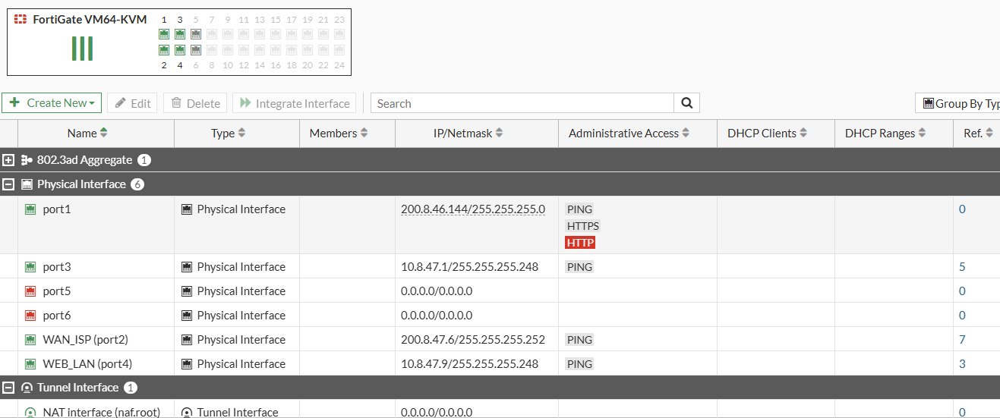

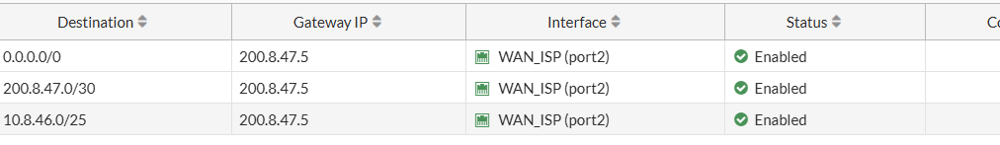

### Jump Server (Windows Server 2019)

- Grupo de trabajo con dominio lab.local (necesario para la consola de Escritorio remoto).
- Roles: Remote Desktop Session Host, RD Web Access y RD Connection Broker.
- Colección "Coleccion" con RemoteApp: PuTTY, RDP (mstsc) y Navegador (Internet Explorer).
- Restricción por grupo: PuTTY y RDP solo para `LAB\usuario_priv`. El Navegador está disponible para todos.
- Usuarios: `usuario_priv` (con privilegios) y `usuario_sinpriv` (sin privilegios), miembros de "Usuarios de escritorio remoto".

### Web Server Caja

Contenedor Linux con SSH (sshd) y un sitio HTTPS en el puerto 443 con certificado autofirmado que muestra "Sistema de Caja". Expone SSH (22), HTTPS (443) y RDP (3389) según la política; RDP no está activo en el contenedor, por lo que las conexiones a 3389 terminan con "TCP reset from server" pero quedan aceptadas por la política.

### Clientes

- **User1-1 (sin privilegios):** contenedor Linux, DHCP de R1 con reserva.
- **PrivilegedUser (con privilegios):** Windows 10, DHCP de R1, cliente de navegador y RemoteApp.

### Objetos y políticas

| Política | Origen | Destino | Servicio | Acción | Propósito |
|---|---|---|---|---|---|
| VPN | usuario_priv (SSL-VPN) + all | JUMP_SERVER | HTTPS, RDP | ACCEPT | Acceso por VPN solo al Jump |
| NO_PRIVILEGE_USER | VLAN10_USUARIOS | JUMP_SERVER | HTTPS | ACCEPT | Web publicado para usuario sin privilegios |
| EXPLICIT_DENY | VLAN10_USUARIOS | JUMP_SERVER | SSH | DENY | Sin SSH al Jump |
| EXPLICIT_DENY_2 | VLAN10_USUARIOS | WEB_CAJA | SSH | DENY | Sin SSH al Web |
| JUMP_TO_WEB | JUMP_SERVER | WEB_CAJA | HTTP, HTTPS, RDP, SSH | ACCEPT | Jump solo accede a los servicios permitidos |
| DENY_JUMP_TO_WEB | JUMP_SERVER | WEB_CAJA | ALL | DENY | Cualquier otro acceso del Jump al Web |

Todas las políticas tienen logging activo (Log All) para dejar evidencia.

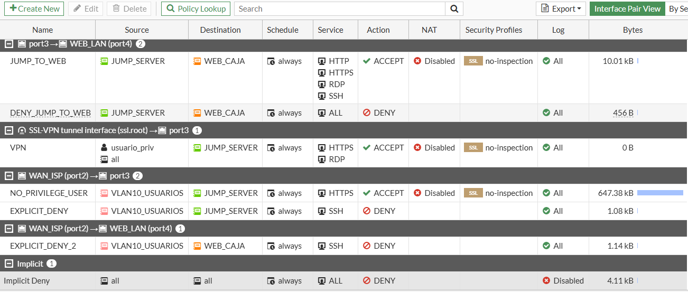

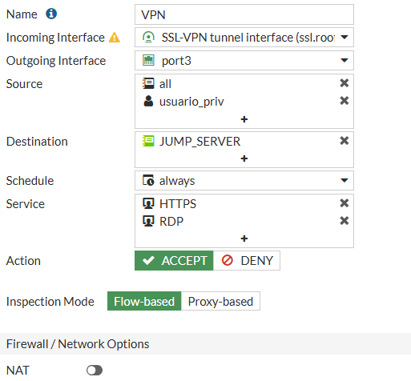

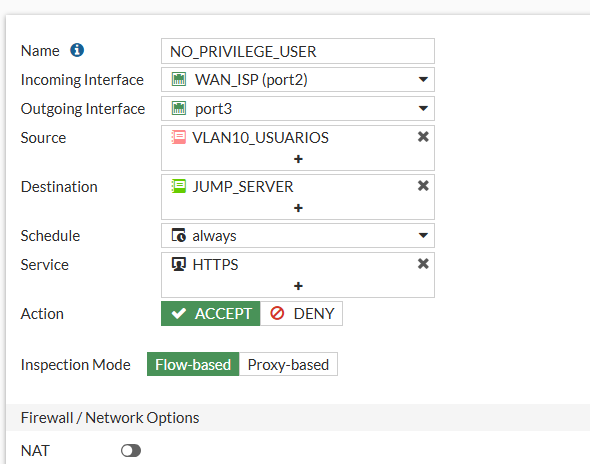

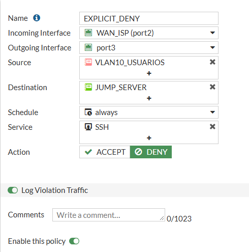

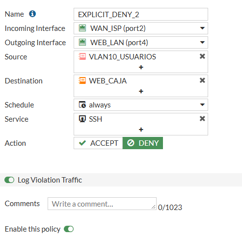

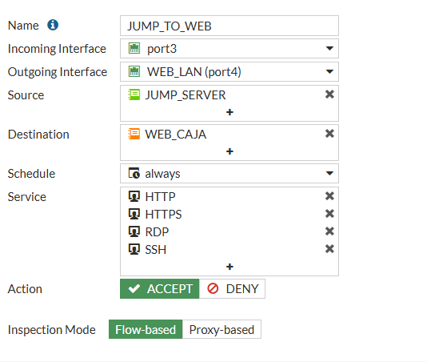

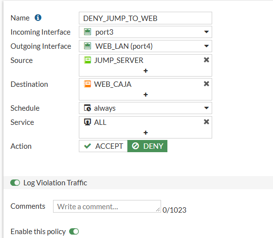

## Pruebas y resultados

### 1. Topología

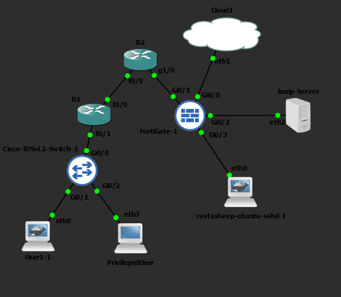

### 2. Usuario sin privilegios (User1-1)

Solo accede por HTTPS al Jump. SSH bloqueado hacia Jump y Web.

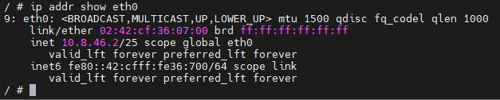

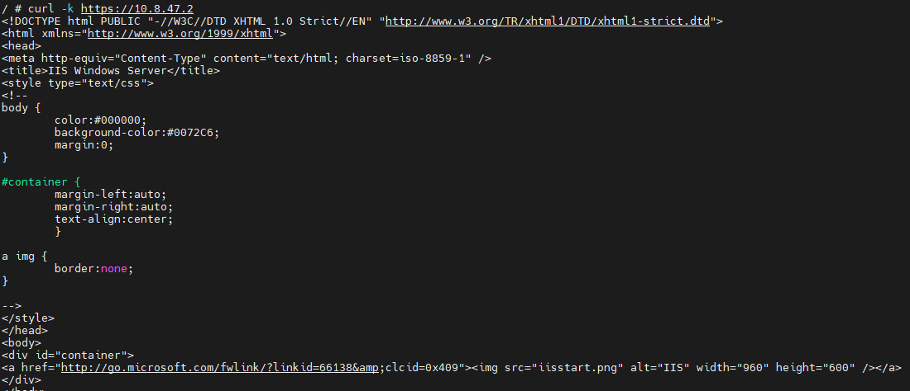

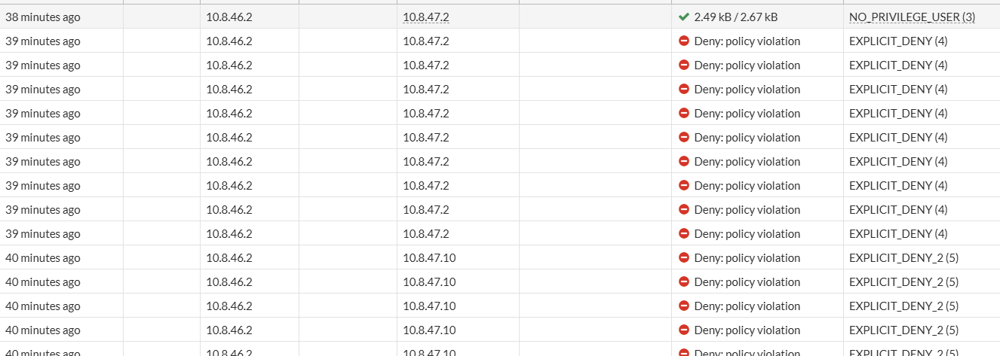

### 3. Usuario con privilegios (PrivilegedUser)

Obtiene IP por DHCP de R1. El acceso RDP directo al Jump está bloqueado, por lo que solo puede entrar por VPN.

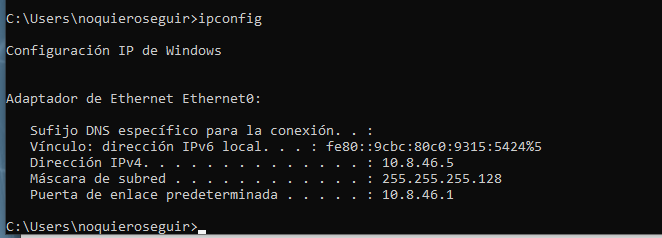

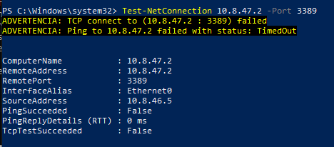

### 4. Acceso por VPN SSL

Login en `https://200.8.47.6:10443` con `usuario_priv`. El portal muestra los bookmarks RDP y Portal_RemoteApp, y RDWeb publica Navegador, PuTTY y RDP.

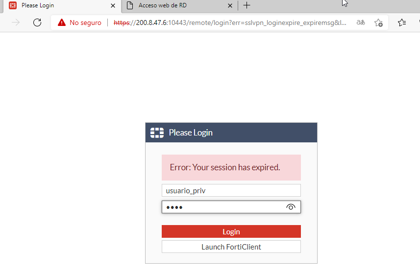

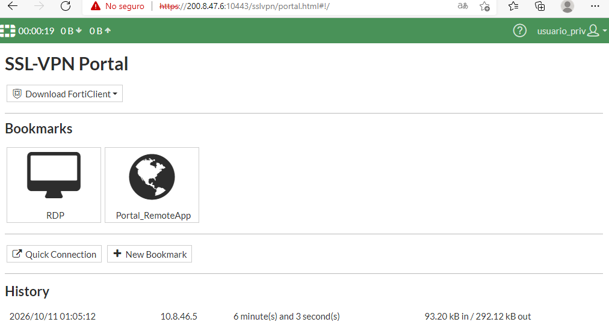

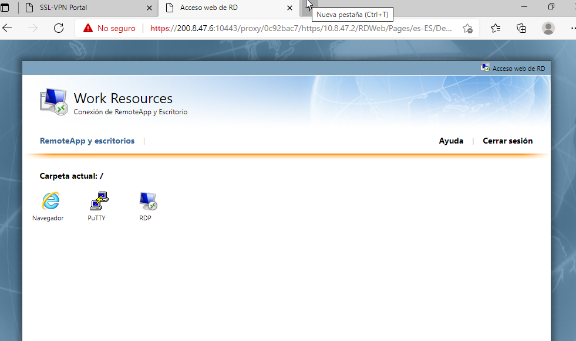

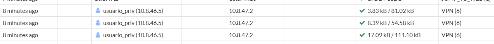

### 5. Jump hacia Web Server

Desde el Jump se permiten HTTPS (443), SSH (22) y RDP (3389) hacia 10.8.47.10. Se deniegan el puerto 8080 y el ping.

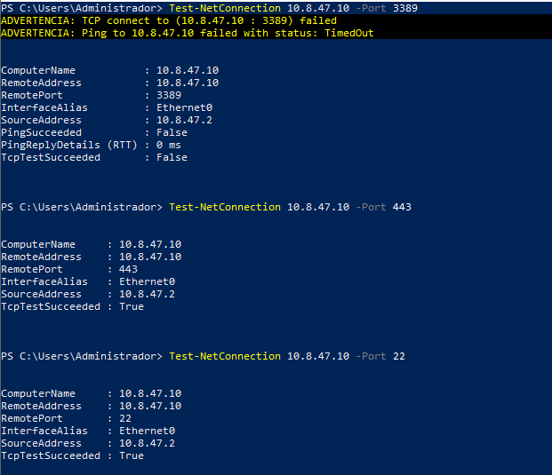

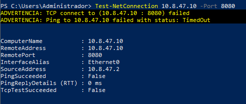

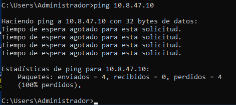

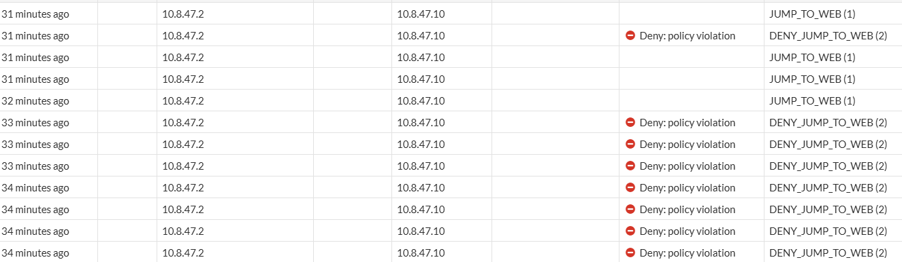

## Running-configs y respaldo

- `configs/r1_running.txt`: running-config de R1.
- `configs/r2_running.txt`: running-config de R2.
- `configs/fortigate_backup.conf`: respaldo de la configuración del FortiGate (System > Configuration > Backup).
